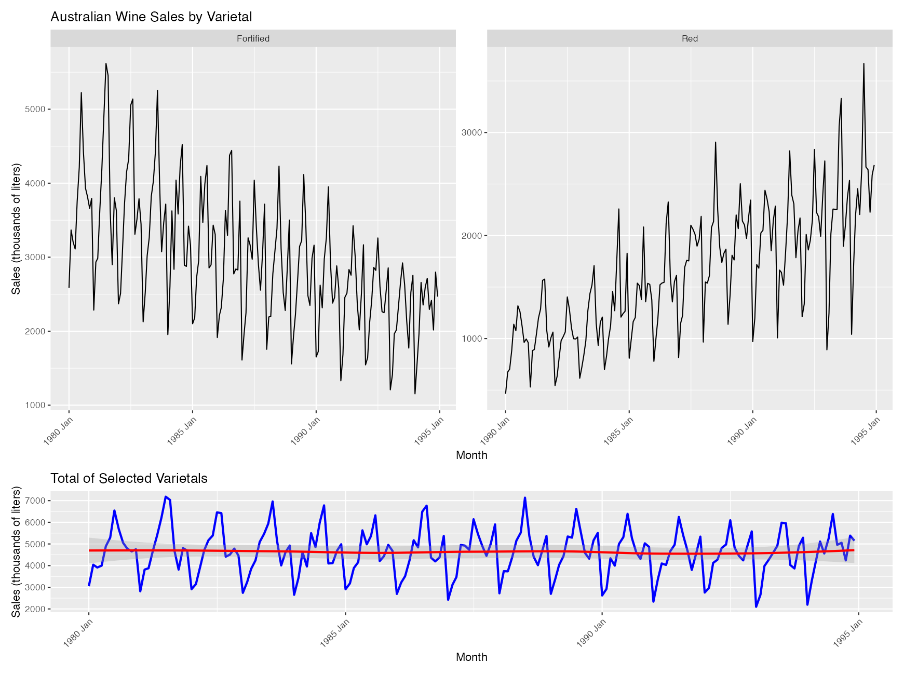

<!-- Keep this entire document to **≤ 2 pages** including screenshots. Remove any guidance text before submitting. -->

## Part I — Links and Description (required)

-   **Deployed Shiny App URL:** https://dsdaveh-ads506-wines-ts-example.share.connect.posit.cloud

-   **Code URL:** GitHub repository: https://github.com/dsdaveh/wineapp_example

<!-- Briefly describe your app , It's main features and how to use it. -->

App Description: The Shiny app allows users to explore and forecast Australian wine sales data. Users can select different wine varietals, adjust model parameters, and visualize forecasts through interactive plots.

App Features:

-   Simple and intuitive user interface for selecting wine varietals.
-   Interactive plots displaying historical sales data and forecasts.
-   Optional floating y-scale adjustment for better visualization.
-   Total sales display for selected wine varietals shows how shifts in varietal preference impact overall sales.

## Part II — Data Story (≤ 2 pages total)

White wine drove total wine sales in Australia, with dry whites accounting for most of the increase in total sales.\
\
Australians wine tastes changed from 1980 to 1995, but the taste for reds was relatively constant with the increase in Red wine sales being offset by a decrease in Fortified wine.

Story board.

1.  Start with all wines selected and "Free Y-Axis scales" unchecked
    -   Observe Rose and Sweet white have very small contributions
    -   Observe that Sparkling is relatively constant (but the December peaks do show trend)
2.  Check Free Y-axis scales and remove Rose, Sweet, and Sparkling
    -   Observe that the trend line is unchanged
3.  Remove Dry White
    -   Observe that the trend is removed